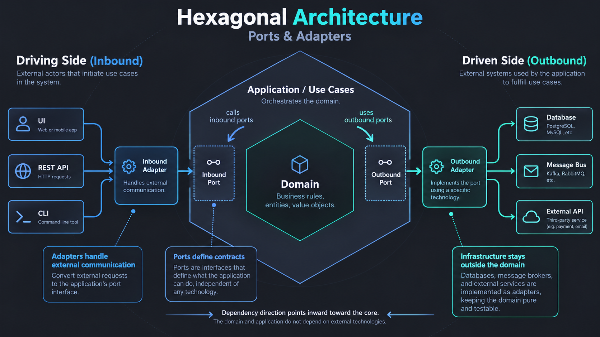

# Hexagonal Architecture — Ports & Adapters

Hexagonal Architecture separates core business behavior from delivery mechanisms and external technology. The **domain** models business rules; the **application** orchestrates use cases and defines contracts; **infrastructure adapters** connect HTTP, databases, messaging, CLIs, and other external systems.

## Boundaries and responsibilities

- **Domain:** Entities, value objects, domain services, and business invariants. It must not depend on the application or infrastructure layers.
- **Application:** Use cases, application services, and ports (contracts). It may depend on the domain, never on infrastructure implementations.
- **Infrastructure:** Inbound adapters (HTTP endpoints, CLI handlers), outbound adapters (databases, external APIs, message brokers), configuration, and dependency wiring. Adapters implement or connect to application contracts.

## Inbound vs. outbound

**Inbound (driving):** External actors invoke the system through an inbound adapter that calls an application use case or inbound port. The application decides what business action runs.

**Outbound (driven):** An application use case depends on an outbound port describing what it needs. An infrastructure adapter implements that contract to access databases, queues, or external services. This inverts source-code dependency even when runtime control flows outward.

## Dependency rules ArchGuard can validate

| Source layer | Permitted layer dependencies |
|---|---|
| Domain | None |
| Application | Domain |
| Infrastructure | Application, Domain |

The authoritative machine-readable profile is [`hexagonal.yaml`](hexagonal.yaml). Project-specific paths are declared in each repository's `architecture.yaml`. An import graph can enforce the rules above for supported static Python imports, but does not establish semantic correctness, framework purity, or full port/adapter conformance.

## Practical review questions

1. Are use cases and domain rules independent of HTTP, SQL, and vendor libraries?
2. Do application ports describe business capabilities rather than specific infrastructure APIs?
3. Do concrete adapters live outside the application and domain?
4. Can an adapter be replaced without rewriting core domain logic?
5. Are extra DTOs, repositories, interfaces, or mappings justified by an actual boundary (KISS/YAGNI)?

Hexagonal Architecture does **not** require DDD, a DTO per entity, or a mandatory repository for every data type. The hexagon is a visual metaphor for multiple interchangeable interfaces, not a prescribed six-sided folder layout.
